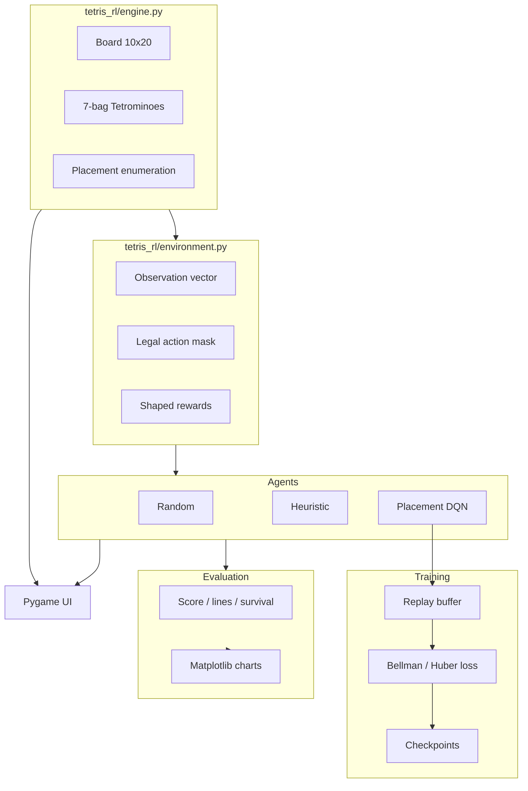

# Tetris-RL

Deep reinforcement learning for Tetris 

A self-contained Python project that implements a Tetris game engine, a Gymnasium placement-level environment, heuristic and random baselines, and a custom PyTorch Deep Q-Network that learns to choose piece placements. Includes reproducible training, evaluation, comparison charts, and a Pygame UI for human play and AI demos.

## Project overview

Agents act at the **placement level**: for each current piece they choose a legal hard-drop (rotation + column), not frame-by-frame keyboard moves. The DQN scores candidate placements from state-action features of the resulting board. Training uses shaped rewards; evaluation reports true game score and lines cleared.

**Why not Stable-Baselines3 DQN?** SB3’s standard DQN expects a fixed discrete action space and does **not** support action masking out of the box. Placement Tetris has a variable legal set each turn, so this project implements a genuine placement-action Q-network in PyTorch. SB3 remains in `requirements.txt` for optional future work (e.g. PPO).

## Architecture



| Path | Role |
|------|------|
| `tetris_rl/engine.py` | Pure game logic (no RL / no rendering) |
| `tetris_rl/features.py` | Board metrics and observation / state-action features |
| `tetris_rl/rewards.py` | Configurable shaped training rewards |
| `tetris_rl/environment.py` | Gymnasium env + legal-action mask |
| `tetris_rl/agents/` | Random, heuristic, DQN |
| `tetris_rl/training/` | Replay buffer, training CLI, heuristic demos / behaviour cloning (`demos.py`), imitation loss (`imitation.py`), diagnostics |
| `tetris_rl/evaluation/` | Seeded evaluation and comparison |
| `tetris_rl/ui/pygame_app.py` | Human play + AI watch mode |
| `scripts/` | Experiment runners, analysis and verification scripts |
| `tests/` | pytest suite (87 tests) |
| `models/` | Checkpoints |
| `results/` | Logs, CSVs, charts, experiment reports (gitignored) |
| `docs/images/` | Charts embedded in this README |

## Installation

Requires **Python 3.11+** (3.12–3.14 also work). The UI depends on `pygame-ce` (API-compatible with pygame; preferred because it provides wheels for newer Python versions).

```bash
cd RL-Tetris
python3 -m venv .venv
source .venv/bin/activate   # Windows: .venv\Scripts\activate
pip install -r requirements.txt
pip install -e .
pytest -q
```

## How to play manually

```bash
export PYTHONPATH=.
python -m tetris_rl.ui.pygame_app --mode human
```

| Key | Action |
|-----|--------|
| ← / → | Move |
| ↑ | Rotate |
| Space | Hard drop |
| 1 / 2 / 3 / 4 | Human / Random / Heuristic / DQN |
| P | Pause |
| R | Restart |
| + / − | AI playback speed |
| Esc | Quit |

## How to train

Two presets:

| Preset | Meaning |
|--------|---------|
| `improved` (default) | Double DQN, LayerNorm, lr=`5e-4`, ε-decay 15k steps, **delta-based** rewards |
| `original` | Pre-audit ablation: vanilla DQN, lr=`1e-3`, absolute-height reward shaping |

```bash
# Recommended
python -m tetris_rl.training.train_dqn --preset improved --episodes 5000 --seed 42

# Ablation (legacy shaping + hparams)
python -m tetris_rl.training.train_dqn --preset original --episodes 400 --seed 42 \
  --checkpoint-dir models/original --log-dir results/train_original
```

Useful flags: `--device cpu|mps|cuda`, `--resume PATH`, `--double-dqn` / `--no-double-dqn`, `--no-tb`.

**Imitation-regularized fine-tuning** (step-budget mode; starts from a behaviour-cloned checkpoint, keeps a cross-entropy loss on persistent heuristic demonstrations active during RL):

```bash
python -m tetris_rl.training.train_dqn --preset improved --reward-mode delta --seed 42 \
  --init-from models/exp_guided/B_bc/seed42/dqn_best.pt \
  --demo-path results/exp_demos/heuristic_demos_train.npz \
  --demo-val-path results/exp_demos/heuristic_demos_val.npz --demo-prefill \
  --imitation-weight 0.1 --epsilon-start 0.05 --epsilon-end 0.05 \
  --max-steps 10000 --eval-at-steps 1000,2500,5000,7500,10000 --eval-at-start \
  --train-seed-base 400000 --checkpoint-dir models/my_run --log-dir results/my_run
```

New flags: `--init-from` (weights + Adam only; counters/ε/buffer fresh), `--imitation-weight λ` (0 = log the imitation loss without optimising it), `--imitation-batch-size`, `--grad-diag-every`, `--train-seed-base`, `--eval-at-steps`. Expert demonstration collection and behaviour-cloning steps are not counted as RL environment steps.

- Checkpoints: `models/*/dqn_best.pt`, `dqn_latest.pt`, `dqn_final.pt`
- Equal-budget A/B script: `bash scripts/run_ab_experiment.sh 400`

## How to evaluate all agents

```bash
# Single agent (greedy / no exploration)
python -m tetris_rl.evaluation.evaluate --agent random --games 100 --seed 0
python -m tetris_rl.evaluation.evaluate --agent heuristic --games 100 --seed 0
python -m tetris_rl.evaluation.evaluate --agent dqn --model models/improved/dqn_best.pt --games 100 --seed 0

# Full A/B: random + heuristic + original DQN + improved DQN
python -m tetris_rl.evaluation.compare_ab --games 100 --seed 0 \
  --original-model models/original/dqn_best.pt \
  --improved-model models/improved/dqn_best.pt \
  --out-dir results/ab_comparison
```

Outputs: summary CSV/JSON, per-game CSVs, charts (`mean_scores.png`, `score_boxplot.png`, `mean_lines.png`).

Eval metrics use **game score / lines cleared** (not shaped training reward). Policies run with ε=0.

## How to launch the AI demo

```bash
python -m tetris_rl.ui.pygame_app --mode human
python -m tetris_rl.ui.pygame_app --mode heuristic
python -m tetris_rl.ui.pygame_app --mode dqn --model models/improved/dqn_best.pt
```

## RL design

### DQN (algorithms implemented)

Placement-action value learning (custom PyTorch; not SB3 DQN):

1. Enumerate legal hard-drop placements.
2. Compute state-action features φ(s, a) for each (resulting board + piece info).
3. Q-network MLP: Q(s, a) = f_θ(φ(s, a)) (optional input LayerNorm in `improved`).
4. ε-greedy selection during training; greedy at eval.
5. Experience replay + Huber (Smooth L1) loss + gradient clipping + hard target sync.
6. Bootstrap: max over legal next actions; **Double DQN** on by default in `improved`
   (online argmax, target evaluation).
7. Terminal → bootstrap target 0.

Audit notes (`results/AUDIT.md`): Bellman/next-action handling were already correct; main learning bugs were reward shaping (absolute height tax) and terminal survival bonus on no-move game-overs.

### State representation

Observation vector includes:

- Board occupancy (10×20)
- Current piece one-hot
- Next (preview) piece one-hot
- Normalized column heights
- Aggregate height, holes, bumpiness, max height
- Lines cleared on the previous step (normalized)

The agent never sees future bag pieces beyond the single preview.

### Action space

Variable legal placements each turn, encoded as indices `0 .. n_legal-1` with a boolean mask of length `MAX_ACTIONS` (40). Agents must only select masked-legal indices. The DQN never scores illegal slots; it only evaluates enumerated placements.

### Reward function (training)

**Improved (default):** delta-based board terms — changes in holes / aggregate height / bumpiness, plus line-clear bonuses, survival bonus, and a large game-over penalty. Filling holes and lowering the stack are rewarded.

**Original (ablation):** absolute aggregate-height penalty every step (dominates returns; kept for comparison only).

**Training reward ≠ evaluation metrics.** Published tables use engine **score** and **lines cleared**.

## Testing

```bash
pytest -q
```

Coverage includes engine, env, rewards (including audit fixes), DQN forward/Double-DQN update, checkpoint save/load, and the imitation loss (legal-action masking, no gradient to the target network, λ=0 equivalent to plain DQN, checkpoint-init fidelity, seed-range disjointness).

## Measured results (executed locally)

### A/B comparison — 100 shared seeded games

Protocol: `--seed 0`, `--max-pieces 500`, ε=0 for DQN agents.

| Agent | Mean score | Median | Best | Mean lines | Mean pieces | Std score |
|-------|------------|--------|------|------------|-------------|-----------|
| Random | 8.0 | 0 | 100 | 0.08 | 25.7 | 27.3 |
| Heuristic | 21153.0 | 21300 | 22800 | 194.0 | 496.4 | 1413.8 |
| DQN original | 566.0 | 500 | 2300 | 5.46 | 48.5 | 405.1 |
| DQN improved | **939.0** | **900** | **2400** | **9.08** | **59.9** | 500.1 |

**Training budgets (verified):**
- **Original:** `--preset original`, 400 episodes, seed 42, max 200 pieces/ep → `models/original/dqn_best.pt`
- **Improved:** `--preset improved`, continued training to ε=0.05 (~19k env steps) → `models/improved/dqn_best.pt`

**Findings (measured, not claimed beyond this):**
- Improved DQN beats original DQN and random on this protocol.
- Neither from-scratch DQN approaches the heuristic within this budget; heuristic rarely tops out before the 500-piece cap. (Behaviour cloning plus imitation-regularized fine-tuning does; see the latest result below.)
- Artifacts: `results/ab_comparison/` (CSV/JSON + charts). Code audit: `results/AUDIT.md`.

### Reproduce

```bash
bash scripts/run_ab_experiment.sh 400   # train both presets + compare
# or evaluate existing checkpoints:
python -m tetris_rl.evaluation.compare_ab --games 100 --seed 0 \
  --original-model models/original/dqn_best.pt \
  --improved-model models/improved/dqn_best.pt
```

### Latest result — imitation-regularized Double DQN

A DQN trained from scratch scores ~1,000 on the validation games above. Behaviour-cloning the heuristic reaches ~21,000 (the "clone"), but ordinary DQN fine-tuning then drifts away from the expert. Adding a persistent imitation loss, `L = L_TD + λ·L_imit` (cross-entropy over legal placements against the heuristic's choice), lets RL improve on the clone: with λ=0.1 the validation score rises above both the clone and the heuristic.


*Mean (top) and median (bottom) greedy validation score over 50 fixed games vs RL environment steps, for seeds 42 and 43. Dashed line = clone at step 0, dotted = 85% of clone, dash-dot = heuristic. Reward, network and all other hyper-parameters are identical across arms; only λ differs.*

| Agent (10k RL steps) | Seed 42 | Seed 43 |
|---|---|---|
| Behaviour clone (no RL) | 20,972 | 21,272 |
| Standard DQN (λ=0) | 22,292 | 21,838 |
| Imitation-regularized, λ=0.1 | **24,612** | **25,926** |
| Imitation-regularized, λ=1.0 | 21,104 | 22,166 |

Caveats: two seeds, validation seeds only (no held-out test evaluation yet), and mean score alone hides risk — λ=0 reaches its score with 32–40% top-out versus 4–18% for λ=0.1. λ=1.0 preserves the clone's behaviour but does not significantly improve on it. Full analysis, loss-scale checks, and all diagnostics: [`results/reports/imitation_regularized_dqn_experiment.md`](results/reports/imitation_regularized_dqn_experiment.md) (local; `results/` is gitignored).

Reproduce (needs the demos and behaviour-clone checkpoints from `scripts/collect_heuristic_demos.py` / `scripts/run_guided_experiment.py`):

```bash
python scripts/run_imitation_experiment.py --tag exp_imitreg --parallel 6
python scripts/analyze_imitation_experiment.py
```

## Limitations and next steps

- No HOLD / full SRS / T-spins / combo scoring
- Placement actions only
- From-scratch DQN is still far weaker than the heuristic; the strong agents here start from a behaviour clone of the heuristic, so the clone's skill is imitation, and only the gain above it (about +17–22% with λ=0.1 on validation seeds) is attributable to RL
- Imitation-regularization results use two seeds, 10k RL steps and validation seeds only; replicate with more seeds, test a λ grid / DQfD-style margin loss or advantage-weighted imitation, and evaluate one chosen checkpoint once on the held-out test seeds
- `--resume` restores the replay buffer, so `dqn_final.pt` / `dqn_latest.pt` can be hundreds of MB; experiment checkpoints (`models/exp_*/`, `models/frozen/`) are gitignored because GitHub rejects files over 100 MB
- Eval `--max-pieces` cap inflates heuristic “survival” vs natural top-out

