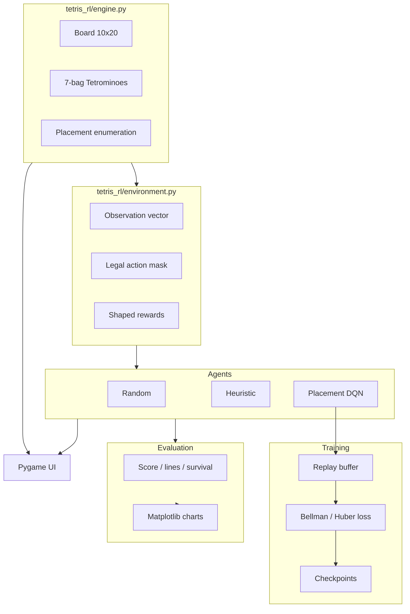

# Tetris-RL

Deep reinforcement learning for Tetris — Cornell CS 4701 AI Practicum.

A self-contained Python project that implements a Tetris game engine, a Gymnasium placement-level environment, heuristic and random baselines, and a custom PyTorch Deep Q-Network that learns to choose piece placements. Includes reproducible training, evaluation, comparison charts, and a Pygame UI for human play and AI demos.

## Project overview

Agents act at the **placement level**: for each current piece they choose a legal hard-drop (rotation + column), not frame-by-frame keyboard moves. The DQN scores candidate placements from state-action features of the resulting board. Training uses shaped rewards; evaluation reports true game score and lines cleared.

**Why not Stable-Baselines3 DQN?** SB3’s standard DQN expects a fixed discrete action space and does **not** support action masking out of the box. Placement Tetris has a variable legal set each turn, so this project implements a genuine placement-action Q-network in PyTorch. SB3 remains in `requirements.txt` for optional future work (e.g. PPO).

## Architecture



| Path | Role |
|------|------|
| `tetris_rl/engine.py` | Pure game logic (no RL / no rendering) |
| `tetris_rl/features.py` | Board metrics and observation / state-action features |
| `tetris_rl/rewards.py` | Configurable shaped training rewards |
| `tetris_rl/environment.py` | Gymnasium env + legal-action mask |
| `tetris_rl/agents/` | Random, heuristic, DQN |
| `tetris_rl/training/` | Replay buffer + training CLI |
| `tetris_rl/evaluation/` | Seeded evaluation and comparison |
| `tetris_rl/ui/pygame_app.py` | Human play + AI watch mode |
| `tests/` | pytest suite |
| `models/` | Checkpoints |
| `results/` | Logs, CSVs, charts |

## Installation

Requires **Python 3.11+** (3.12–3.14 also work). The UI depends on `pygame-ce` (API-compatible with pygame; preferred because it provides wheels for newer Python versions).

```bash
cd RL-Tetris
python3 -m venv .venv
source .venv/bin/activate   # Windows: .venv\Scripts\activate
pip install -r requirements.txt
pip install -e .
pytest -q
```

## How to play manually

```bash
export PYTHONPATH=.
python -m tetris_rl.ui.pygame_app --mode human
```

| Key | Action |
|-----|--------|
| ← / → | Move |
| ↑ | Rotate |
| Space | Hard drop |
| 1 / 2 / 3 / 4 | Human / Random / Heuristic / DQN |
| P | Pause |
| R | Restart |
| + / − | AI playback speed |
| Esc | Quit |

## How to train

```bash
export PYTHONPATH=.
python -m tetris_rl.training.train_dqn --episodes 5000 --seed 42
```

Useful flags:

```bash
python -m tetris_rl.training.train_dqn \
  --episodes 5000 \
  --seed 42 \
  --device cpu \
  --lr 1e-3 \
  --double-dqn \
  --checkpoint-dir models \
  --log-dir results/train_logs \
  --resume models/dqn_latest.pt
```

- Checkpoints: `models/dqn_latest.pt`, `models/dqn_best.pt`, `models/dqn_final.pt`
- CSV metrics: `results/train_logs/training_metrics.csv`
- TensorBoard: `tensorboard --logdir results/train_logs/tb`

Smoke test (short run):

```bash
bash scripts/run_smoke_train.sh
```

## How to evaluate all agents

```bash
export PYTHONPATH=.

# Single agent
python -m tetris_rl.evaluation.evaluate --agent random --games 100 --seed 0
python -m tetris_rl.evaluation.evaluate --agent heuristic --games 100 --seed 0
python -m tetris_rl.evaluation.evaluate --agent dqn --model models/dqn_best.pt --games 100 --seed 0

# Compare on the same seeded set (≥100 games)
python -m tetris_rl.evaluation.compare --games 100 --seed 0 --model models/dqn_best.pt
```

Outputs under `results/comparison/`: summary CSV/JSON, per-game CSVs, and charts (`mean_scores.png`, `score_boxplot.png`, `mean_lines.png`).

Reported metrics: mean/median/std score, mean/median lines, average pieces placed, best score, survival length, top-out rate.

## How to launch the AI demo

```bash
export PYTHONPATH=.
python -m tetris_rl.ui.pygame_app --mode heuristic
python -m tetris_rl.ui.pygame_app --mode dqn --model models/dqn_best.pt
```

## RL design

### DQN

Placement-action value learning:

1. Enumerate legal hard-drop placements.
2. Compute state-action features φ(s, a) for each (resulting board + piece info).
3. Q-network: Q(s, a) = f_θ(φ(s, a)).
4. ε-greedy selection during training; greedy at eval.
5. Store transitions in a replay buffer.
6. Train with Huber (Smooth L1) loss, gradient clipping, target network.
7. Bootstrap with max Q over legal actions in the next state (optional Double DQN).

Terminal states target Q = 0 (no bootstrap).

### State representation

Observation vector includes:

- Board occupancy (10×20)
- Current piece one-hot
- Next (preview) piece one-hot
- Normalized column heights
- Aggregate height, holes, bumpiness, max height
- Lines cleared on the previous step (normalized)

The agent never sees future bag pieces beyond the single preview.

### Action space

Variable legal placements each turn, encoded as indices `0 .. n_legal-1` with a boolean mask of length `MAX_ACTIONS` (40). Agents must only select masked-legal indices. The DQN never scores illegal slots; it only evaluates enumerated placements.

### Reward function (training)

Configurable shaping in `tetris_rl/rewards.py`:

- Positive reward for 1–4 line clears (larger for Tetrises)
- Penalty for creating holes
- Small penalties for stack height and bumpiness
- Large penalty for game over
- Optional small survival bonus

**Training reward ≠ evaluation metrics.** Shaped reward guides learning; published comparisons use **game score** and **lines cleared** from the engine.

## Testing

```bash
export PYTHONPATH=.
pytest -q
```

Coverage includes rotations, placements, collisions, line clears, game over, reproducibility, observations, legal actions, rewards, DQN forward/update, and checkpoint save/load.

## Example measured results (executed locally)

These numbers come from a real 100-game comparison (`--seed 0`, `--max-pieces 500`) after training DQN for **500 episodes** (not the full 5000). Re-run evaluation after longer training for updated figures.

| Agent | Mean score | Median score | Mean lines | Mean pieces | Top-out rate |
|-------|------------|--------------|------------|-------------|--------------|
| Random | 8.0 | 0.0 | 0.08 | 25.7 | 1.00 |
| Heuristic | 21153.0 | 21300.0 | 194.0 | 496.4 | 0.02 |
| DQN (500 eps) | 751.0 | 650.0 | 7.3 | 52.8 | 1.00 |

Notes:
- Heuristic rarely tops out within 500 pieces, so its score is largely “score accumulated before the piece cap.”
- DQN beats random after short training but remains well below the strong hand-crafted heuristic; longer training (`--episodes 5000`) is expected to close some of the gap.
- Artifacts: `results/comparison/comparison_summary.csv`, `mean_scores.png`, `score_boxplot.png`, `mean_lines.png`.

## Limitations and future work

- No HOLD / wall kicks / full SRS / T-spins / combo scoring modes
- Placement actions only (no DAS / soft-drop timing)
- Vanilla / Double DQN; PPO or distributional RL could improve sample efficiency
- Heuristic weights are hand-tuned, not optimized
- Longer training and hyperparameter sweeps recommended for stronger play
- Evaluation uses a `--max-pieces` safety cap (default 500)

## License

Course project code — use and modify freely for educational purposes.
