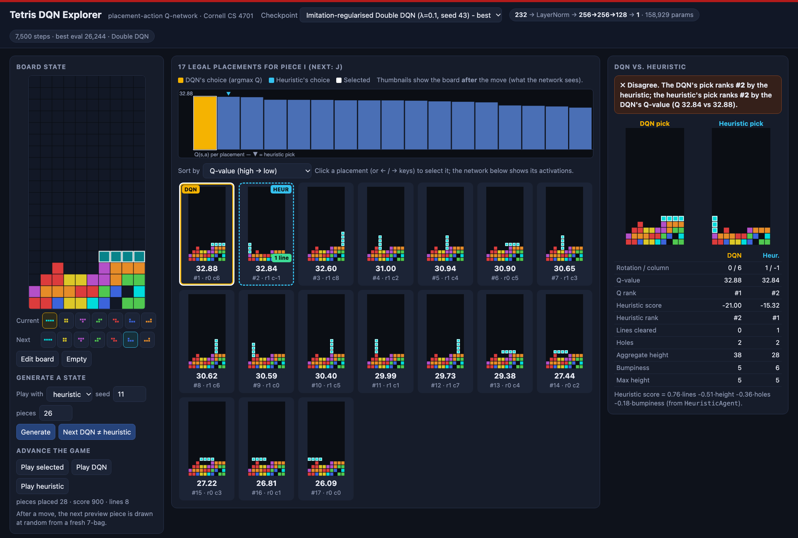
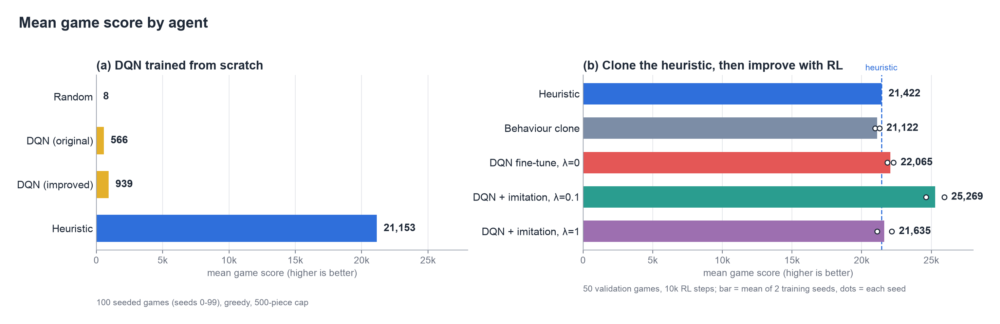
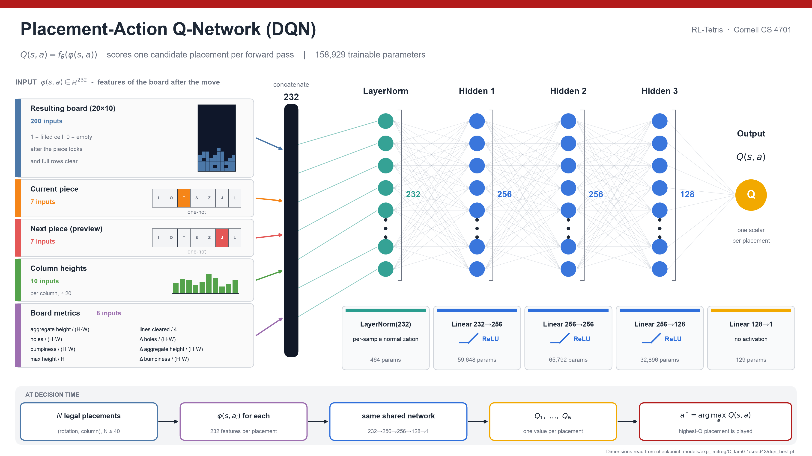
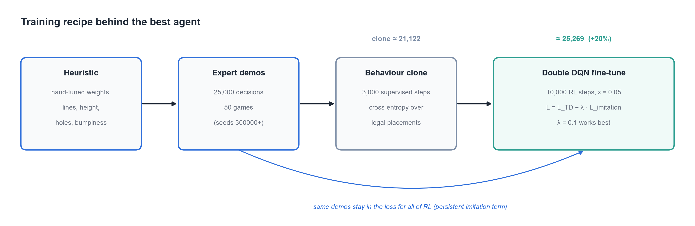
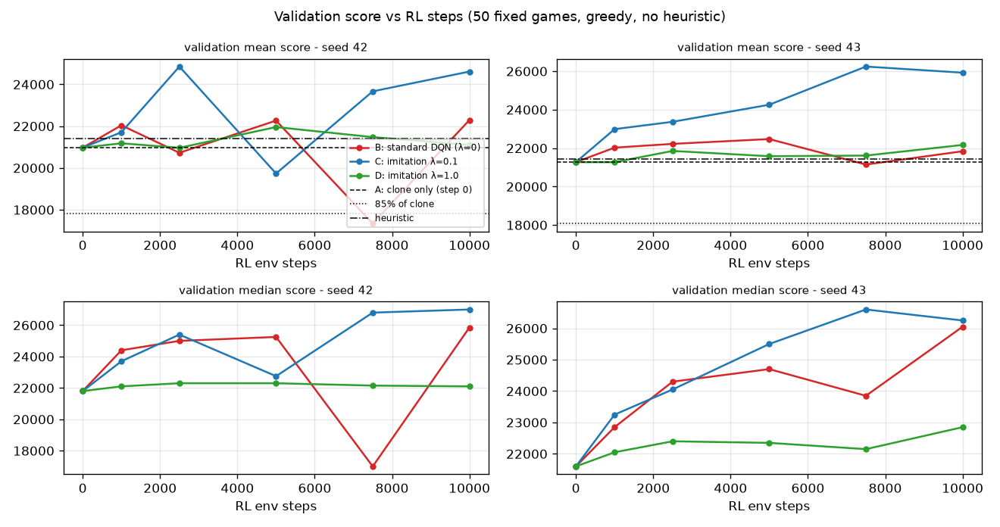
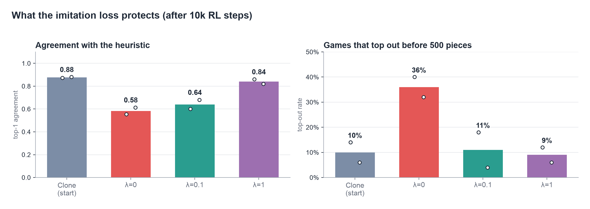
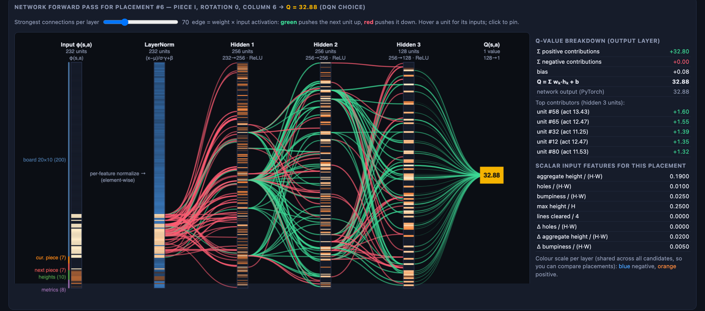
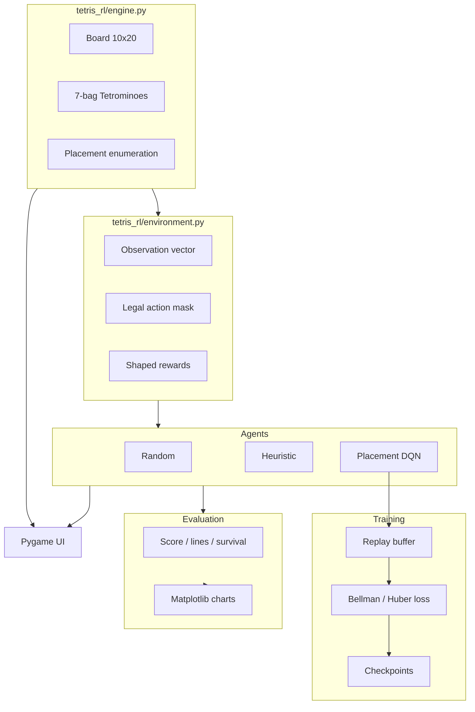

# Tetris-RL

Deep reinforcement learning for Tetris: a custom placement-action DQN in PyTorch, a heuristic baseline it learns from, and an interactive tool to see inside the network. Cornell CS 4701.



*The interactive network explorer ([how to launch](#explore-the-network)): every legal placement scored by the trained DQN, compared with the heuristic's choice.*

## Highlights

- **Placement-level agents.** For each piece, agents choose a legal hard-drop (rotation + column) rather than frame-by-frame key presses.
- **A DQN that scores moves, not actions.** One shared network maps the features of the *resulting* board to a Q-value, so a variable number of legal moves is handled without action masking.
- **Learning from a heuristic.** A DQN trained from scratch scores ~1k; behaviour-cloning the heuristic and fine-tuning with an imitation-regularized Double DQN reaches ~25k, above the heuristic itself (2 seeds, validation games).
- **Reproducible and tested.** Seeded evaluation, experiment scripts, and 102 pytest tests.



## The model



`Q(s, a) = f_θ(φ(s, a))`: for each legal placement, compute the 232 features of the board after the move, normalize (LayerNorm), pass through three ReLU layers (256 → 256 → 128), and read out one scalar. The agent plays `argmax_a Q(s, a)`. 158,929 parameters. Vector version: [`dqn_architecture.svg`](docs/images/dqn_architecture.svg).

**Why not Stable-Baselines3 DQN?** SB3's DQN expects a fixed discrete action space and has no built-in action masking, while placement Tetris has a different legal set every turn. SB3 stays in `requirements.txt` for possible future work (e.g. PPO).

## Results

### Training recipe behind the best agent



A DQN trained from scratch stays far from the heuristic. Behaviour-cloning the heuristic gets to its level, but plain DQN fine-tuning then drifts away from it. Adding a persistent imitation loss, `L = L_TD + λ·L_imit` (cross-entropy over legal placements against the heuristic's choice), lets RL improve on the clone: with λ=0.1 the validation score rises above both the clone and the heuristic.



*Mean (top) and median (bottom) greedy validation score over 50 fixed games vs RL environment steps, seeds 42 and 43. Dashed = clone at step 0, dotted = 85% of clone, dash-dot = heuristic. Only λ differs between arms.*



*Without the imitation term (λ=0), the policy drifts from the expert and tops out more often; λ=0.1 improves the score while keeping top-outs near the clone's level; λ=1 preserves the clone but does not improve on it.*

<details>
<summary>Numbers and caveats</summary>

**From scratch: 100 shared seeded games** (`--seed 0`, `--max-pieces 500`, ε=0):

| Agent | Mean score | Median | Best | Mean lines | Mean pieces |
|-------|-----------:|-------:|-----:|-----------:|------------:|
| Random | 8.0 | 0 | 100 | 0.08 | 25.7 |
| Heuristic | 21153.0 | 21300 | 22800 | 194.0 | 496.4 |
| DQN original | 566.0 | 500 | 2300 | 5.46 | 48.5 |
| DQN improved | **939.0** | **900** | **2400** | **9.08** | **59.9** |

Original: `--preset original`, 400 episodes, seed 42. Improved: `--preset improved`, continued to ε=0.05 (~19k env steps). Neither from-scratch DQN approaches the heuristic within this budget.

**Imitation-regularized fine-tuning (10k RL steps, mean validation score over 50 games):**

| Agent | Seed 42 | Seed 43 |
|---|---:|---:|
| Behaviour clone (no RL) | 20,972 | 21,272 |
| Standard DQN (λ=0) | 22,292 | 21,838 |
| Imitation-regularized, λ=0.1 | **24,612** | **25,926** |
| Imitation-regularized, λ=1.0 | 21,104 | 22,166 |

Caveats: two seeds, validation seeds only (no held-out test evaluation yet), and mean score hides risk: λ=0 reaches its score with 32–40% top-out versus 4–18% for λ=0.1. λ=1.0 preserves the clone's behaviour but does not significantly improve on it. The strong agents start from a behaviour clone, so the clone's skill is imitation; only the gain above it (about +17–22% with λ=0.1) is attributable to RL. Full analysis: `results/reports/imitation_regularized_dqn_experiment.md` (local; `results/` is gitignored).

Reproduce (needs the demos and clone checkpoints from `scripts/collect_heuristic_demos.py` / `scripts/run_guided_experiment.py`):

```bash
python scripts/run_imitation_experiment.py --tag exp_imitreg --parallel 6
python scripts/analyze_imitation_experiment.py
python -m tetris_rl.visualization.results_figures      # regenerate the figures above
```

</details>

## Explore the network



*Forward pass for one candidate move. Edges are weight × activation (green pushes the next unit up, red pushes it down). The side panel decomposes the final Q-value exactly.*

```bash
export PYTHONPATH=.        # or `pip install -e .`
python -m tetris_rl.visualization.explorer                                  # opens http://127.0.0.1:8765
python -m tetris_rl.visualization.explorer --model models/improved/dqn_best.pt
```

It loads a real checkpoint (default: the first existing of `models/exp_imitreg/C_lam0.1/seed43/dqn_best.pt` or `models/improved/dqn_best.pt`; any `models/**/*.pt` works from the dropdown), serves a self-contained page on localhost, and needs no extra dependencies.

- **Pick a state:** play N pieces with an agent from a seed, jump to the **next position where the DQN and heuristic disagree**, or paint the board by hand and choose the current and next piece.
- **See every legal placement** with its resulting board, Q-value and rank; the DQN's choice and the heuristic's choice are highlighted.
- **Compare** the two agents' picks side by side (Q-value, heuristic score, lines, holes, height, bumpiness).
- **Inspect the network:** per-layer activations, strongest connections, per-unit inputs on hover/click, and the exact `Q = Σ wₖhₖ + b` breakdown.
- **Play forward** with the selected, DQN or heuristic move. `←` / `→` step through placements.

Shareable links work too, e.g. `http://127.0.0.1:8765/?seed=11&pieces=26&disagree=1`.

Regenerate the architecture diagram (SVG + PNG): `python -m tetris_rl.visualization.architecture_diagram --out-dir docs/images`.

## Quick start

Requires **Python 3.11+** (3.12–3.14 also work). The UI uses `pygame-ce` (API-compatible with pygame, with wheels for newer Python versions).

```bash
cd RL-Tetris
python3 -m venv .venv && source .venv/bin/activate   # Windows: .venv\Scripts\activate
pip install -r requirements.txt
pip install -e .
pytest -q
```

**Play / watch** (Pygame; keys: ← → move, ↑ rotate, Space drop, 1–4 switch Human/Random/Heuristic/DQN, P pause, R restart, +/− speed):

```bash
python -m tetris_rl.ui.pygame_app --mode human
python -m tetris_rl.ui.pygame_app --mode heuristic
python -m tetris_rl.ui.pygame_app --mode dqn --model models/improved/dqn_best.pt
```

**Train:**

```bash
python -m tetris_rl.training.train_dqn --preset improved --episodes 5000 --seed 42
```

**Evaluate** (greedy, ε=0; reports game score and lines, not shaped reward):

```bash
python -m tetris_rl.evaluation.evaluate --agent heuristic --games 100 --seed 0
python -m tetris_rl.evaluation.evaluate --agent dqn --model models/improved/dqn_best.pt --games 100 --seed 0
python -m tetris_rl.evaluation.compare_ab --games 100 --seed 0 \
  --original-model models/original/dqn_best.pt --improved-model models/improved/dqn_best.pt \
  --out-dir results/ab_comparison
```

<details>
<summary>More training options (presets, imitation fine-tuning)</summary>

| Preset | Meaning |
|--------|---------|
| `improved` (default) | Double DQN, LayerNorm, lr `5e-4`, ε-decay 15k steps, **delta-based** rewards |
| `original` | Pre-audit ablation: vanilla DQN, lr `1e-3`, absolute-height reward shaping |

```bash
# Ablation (legacy shaping + hyper-parameters)
python -m tetris_rl.training.train_dqn --preset original --episodes 400 --seed 42 \
  --checkpoint-dir models/original --log-dir results/train_original

# Imitation-regularized fine-tuning from a behaviour-cloned checkpoint
python -m tetris_rl.training.train_dqn --preset improved --reward-mode delta --seed 42 \
  --init-from models/exp_guided/B_bc/seed42/dqn_best.pt \
  --demo-path results/exp_demos/heuristic_demos_train.npz \
  --demo-val-path results/exp_demos/heuristic_demos_val.npz --demo-prefill \
  --imitation-weight 0.1 --epsilon-start 0.05 --epsilon-end 0.05 \
  --max-steps 10000 --eval-at-steps 1000,2500,5000,7500,10000 --eval-at-start \
  --train-seed-base 400000 --checkpoint-dir models/my_run --log-dir results/my_run
```

Useful flags: `--device cpu|mps|cuda`, `--resume PATH`, `--double-dqn` / `--no-double-dqn`, `--no-tb`, `--init-from` (weights + Adam only), `--imitation-weight λ` (0 = log only), `--imitation-batch-size`, `--grad-diag-every`, `--train-seed-base`, `--eval-at-steps`. Checkpoints are written to `models/*/dqn_best.pt`, `dqn_latest.pt`, `dqn_final.pt`. Equal-budget A/B: `bash scripts/run_ab_experiment.sh 400`.

</details>

## Project layout

| Path | Role |
|------|------|
| `tetris_rl/engine.py` | Pure game logic (no RL, no rendering) |
| `tetris_rl/features.py` | Board metrics and state-action features |
| `tetris_rl/rewards.py` | Configurable shaped training rewards |
| `tetris_rl/environment.py` | Gymnasium env + legal-action mask |
| `tetris_rl/agents/` | Random, heuristic, DQN |
| `tetris_rl/training/` | Replay buffer, training CLI, demos / behaviour cloning, imitation loss, diagnostics |
| `tetris_rl/evaluation/` | Seeded evaluation and comparison |
| `tetris_rl/ui/pygame_app.py` | Human play + AI watch mode |
| `tetris_rl/visualization/` | Read-only tooling: network explorer, architecture diagram, result figures |
| `scripts/`, `tests/` | Experiment runners / analysis; pytest suite (102 tests) |
| `models/`, `results/`, `docs/images/` | Checkpoints; logs and reports (gitignored); images used in this README |

<details>
<summary>Code architecture diagram</summary>



</details>

<details>
<summary>RL design (DQN, state, actions, reward)</summary>

**DQN.** Placement-action value learning (custom PyTorch):

1. Enumerate legal hard-drop placements.
2. Compute state-action features φ(s, a) for each (resulting board + piece info).
3. Q-network MLP: `Q(s, a) = f_θ(φ(s, a))` (input LayerNorm in `improved`).
4. ε-greedy selection during training; greedy at evaluation.
5. Experience replay, Huber (Smooth L1) loss, gradient clipping, hard target sync.
6. Bootstrap from the max over legal next actions; **Double DQN** (online argmax, target evaluation) is on in `improved`.
7. Terminal states bootstrap to 0.

Audit notes (`results/AUDIT.md`): Bellman and next-action handling were already correct; the main learning bugs were reward shaping (absolute height tax) and a terminal survival bonus on no-move game-overs.

**State representation** (232-d input to the DQN): resulting board occupancy (200), current piece one-hot (7), next piece one-hot (7), column heights (10), and 8 scalars (aggregate height, holes, bumpiness, max height, lines cleared, and the before-to-after change in holes / height / bumpiness). The agent never sees pieces beyond the single preview.

**Action space.** Variable legal placements each turn, indexed `0 .. n_legal-1` with a boolean mask of length `MAX_ACTIONS` (40). The DQN only scores enumerated placements.

**Reward (training).** Improved (default): delta-based board terms (changes in holes / aggregate height / bumpiness), line-clear bonuses, a survival bonus and a large game-over penalty. Original (ablation): an absolute aggregate-height penalty every step. Training reward is not the evaluation metric: published tables use engine **score** and **lines cleared**.

</details>

## Limitations and next steps

- No HOLD / full SRS / T-spins / combo scoring; placement actions only.
- From-scratch DQN is still far weaker than the heuristic; the strong agents start from a behaviour clone of it.
- Imitation-regularization results use two seeds, 10k RL steps and validation seeds only. Next: more seeds, a finer λ grid, a DQfD-style margin loss, then a single held-out test-seed evaluation.
- `--resume` restores the replay buffer, so `dqn_final.pt` / `dqn_latest.pt` can be hundreds of MB; experiment checkpoints (`models/exp_*/`, `models/frozen/`) are gitignored because GitHub rejects files over 100 MB.
- The evaluation `--max-pieces` cap inflates heuristic "survival" relative to natural top-out.
